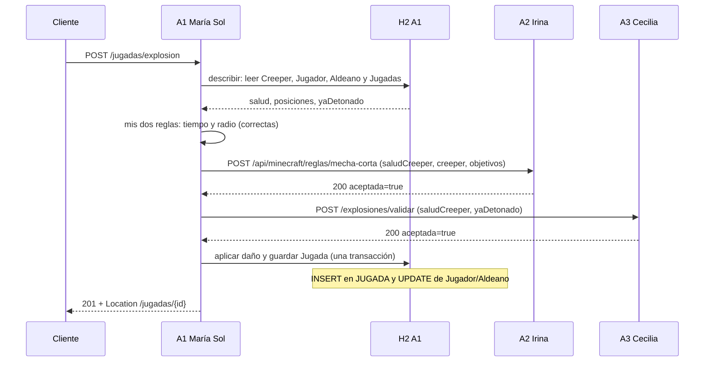
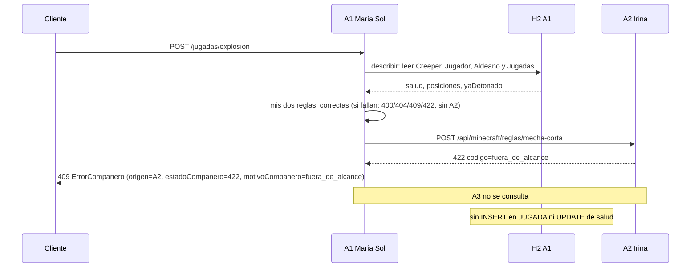
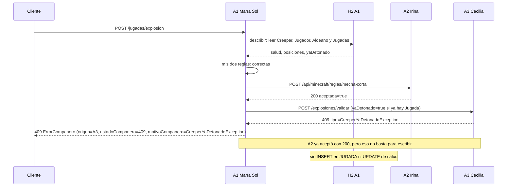
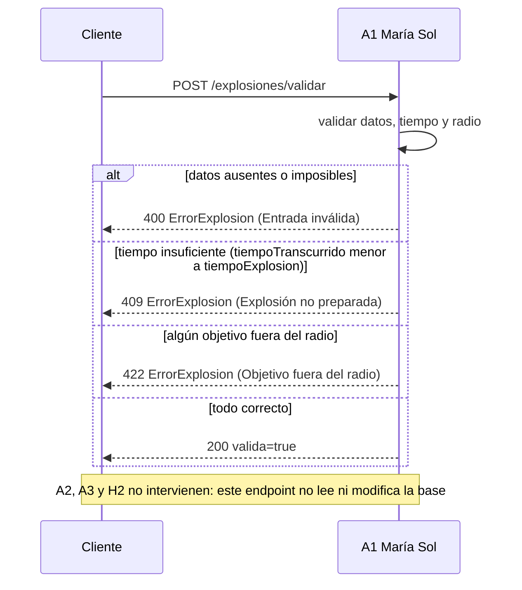
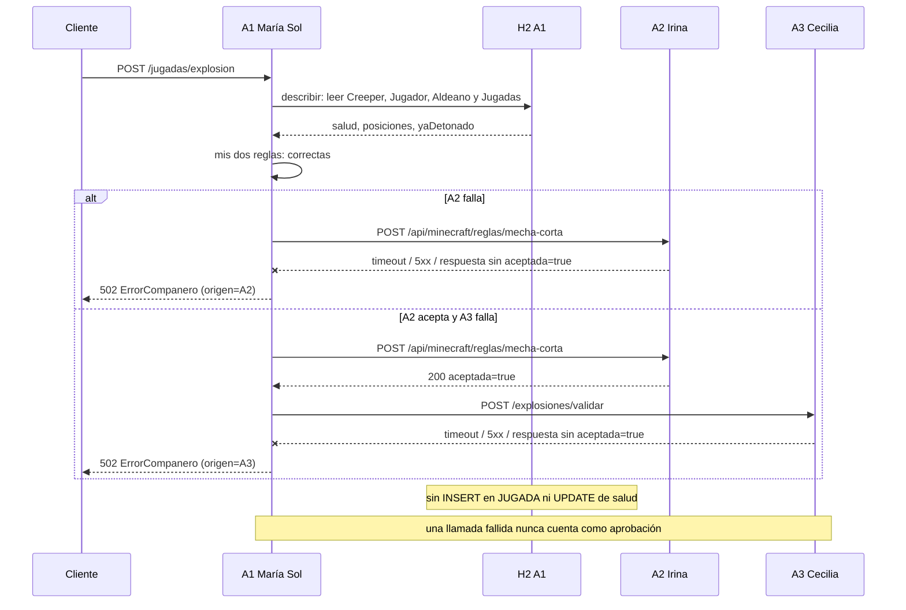

# Minecraft - POO-09 (APIs cruzadas) sobre POO-08

Servicio HTTP de LP3 desarrollado con Java 21, Spring Boot, JPA y H2. Conserva la jerarquía, el polimorfismo, los constructores sobrecargados, el CRUD y la simulación de las etapas anteriores, publica su OpenAPI y, en POO-09, consume las reglas de dos compañeras del grupo Minecraft.

Autora: María Sol Ferreira (A1 de esta entrega).

## Situación de POO-08

POO-08 tuvo observaciones (19/24, [commit corregido `8cd5f741f377c8d22e323d818658807c440e889c`](https://github.com/MariaSol45/msferreira-tplp3-2026/commit/8cd5f741f377c8d22e323d818658807c440e889c)). Todas quedaron cerradas:

| Criterio | Observación | Cómo se cerró |
|---|---|---|
| 1. Entrega y arranque (2,5) | El enlace al commit no era visible y usaba el hash abreviado. | Esta entrega usa el enlace completo con el hash entero, copiado de la pestaña Commits. |
| 2. Organización en paquetes (2) | El dominio lanzaba `IllegalArgumentException`, `ExplosionNoPreparadaException` y `ObjetivoFueraDeRangoException`. | Las entidades quedaron solo con estado: sin validaciones, sin `validarEstado()`, sin callbacks `@PrePersist/@PreUpdate` y sin `throw`. `EntidadService` y `ExplosionService` validan y lanzan. Las excepciones de las reglas se movieron de `domain.exception` a `service.exception`. Como mejora, `EntidadRepository` declara `findBySaludGreaterThan`. |
| 3. Ocultamiento e invariantes (0) | Un POST de Jugador con salud 0 y otro con salud 5000 respondían 201; `setSalud` público permitía cambiar la salud desde afuera. | `EntidadService` exige salud inicial entre 1 y 20 (máximo vanilla) para Jugador, Creeper y Aldeano: los dos POST responden 400 y la colección no crece (pruebas en `EntidadCrudIntegrationTests` y en la colección POO-08). Se eliminaron los setters públicos; el daño pasa por `EntidadService.aplicarDano`. |
| 4. Herencia (mejora) | `GET /ui` armaba instancias nuevas. | `GET /ui?id=...` lee la entidad persistida que implementa `UICapable`. |
| 6. Comportamiento observable (mejora) | Las reglas vivían en `Creeper.explotar(int)` y `Creeper.validarObjetivoDentroDelRadio`. | Las dos reglas están en `ExplosionService` (`validarDetonacion` y `validarObjetivoDentroDelRadio`). |
| 8. Documentación (2,5) | README y `ESPECIFICACION-POO08.md` decían que el enlace "se debe copiar en Classroom después". | Se quitaron esas frases de estado y la documentación enlaza el commit completo. |

Commits del cierre: [`d14f1b7633bf71b9a0efda935b18c2c654857580`](https://github.com/MariaSol45/msferreira-tplp3-2026/commit/d14f1b7633bf71b9a0efda935b18c2c654857580) (validaciones en service, salud 1 a 20, pruebas, Insomnia) y [`896b9a75ded135ee88ee0a69e2605bff75ff3418`](https://github.com/MariaSol45/msferreira-tplp3-2026/commit/896b9a75ded135ee88ee0a69e2605bff75ff3418) (excepciones de las reglas a `service.exception`).

Referencias: [enunciado POO-08](https://github.com/alefq/afq-taller-git-2024/blob/main/docs/ejercicio-poo-08-crud-h2-insomnia-2026-10-28.md), [enunciado POO-09](https://github.com/alefq/afq-taller-git-2024/blob/main/docs/ejercicio-poo-09-apis-cruzadas-2026-11-16.md), [rúbrica](https://github.com/alefq/afq-taller-git-2024/blob/main/docs/RUBRICA-ejercicios-lp3-2026.md) y [especificación histórica POO-06](ESPECIFICACION-POO06.md).

## POO-09: APIs cruzadas

### Mapa del grupo (Minecraft)

| Rol | Integrante | URL base (Tailscale) | OpenAPI | Regla que aporta |
|---|---|---|---|---|
| A1 | María Sol Ferreira (este servicio) | `http://100.87.131.50:8080` (local: `http://localhost:8080`) | `http://100.87.131.50:8080/v3/api-docs` (JSON), `/v3/api-docs.yaml`, Swagger UI en `/swagger-ui.html` | (1) Un Creeper solo explota si `tiempoTranscurrido >= tiempoExplosion`; si no, 409. (2) Todos los objetivos tienen que estar a una distancia euclídea del Creeper menor o igual al radio de explosión; si no, 422 y nadie recibe daño. |
| A2 | Irina | `http://100.87.95.24:8082` | `http://100.87.95.24:8082/v3/api-docs` | `POST /api/minecraft/reglas/mecha-corta`: un Creeper vivo solo detona si hay un jugador vivo a 3 bloques o menos. 200 acepta; 422 `fuera_de_alcance`; 409 `entidad_muerta`; 400 `dato_invalido`. |
| A3 | Cecilia | `http://100.122.114.103:8083` | `http://100.122.114.103:8083/v3/api-docs` | `POST /explosiones/validar`: un Creeper muerto no detona (422) y uno que ya detonó no vuelve a detonar (409). |

Mis dos reglas para el grupo se consumen con [`POST /explosiones/validar`](minecraft/src/main/java/py/edu/uc/lp3/msferreira/minecraft/rest/controller/ExplosionController.java), que evalúa las reglas con los datos del cuerpo y no lee ni modifica mi H2. Código de las reglas: [`ExplosionService`](minecraft/src/main/java/py/edu/uc/lp3/msferreira/minecraft/service/ExplosionService.java). Ese endpoint sigue respondiendo 200, 400, 409 y 422 y no fue modificado.

Los contratos de A2 y A3 se consultaron en sus OpenAPI reales y se adaptaron en `armarCuerpo` de [`ClienteA2`](minecraft/src/main/java/py/edu/uc/lp3/msferreira/minecraft/service/companero/ClienteA2.java) y [`ClienteA3`](minecraft/src/main/java/py/edu/uc/lp3/msferreira/minecraft/service/companero/ClienteA3.java):

- A2 recibe `{"saludCreeper":20,"creeper":{"x":0,"y":0,"z":0},"objetivos":[{"tipo":"jugador","salud":20,"posicion":{"x":2,"y":0,"z":0}}]}`. El cliente interpreta `aceptada`, `codigo`, `mensaje` y `regla` de la respuesta y conserva el cuerpo original del rechazo.
- A3 recibe `{"saludCreeper":20,"yaDetonado":false}`. Ambos valores salen de mi H2: la salud del `Creeper` y si ya existe una `Jugada` registrada para ese `creeperId`.

No se usa `localhost` para llamar a A2 ni a A3: las URLs por defecto son las IP de Tailscale y se pueden cambiar sin tocar Java.

### Escenario

`POST /jugadas/explosion` con `{"creeperId", "jugadorId", "aldeanoId", "tiempoTranscurrido"}`: un Creeper explota sobre un Jugador y un Aldeano guardados en mi H2, y la jugada se guarda solo si A2 y A3 la aceptan.

Índice de los cinco diagramas exigidos por la rúbrica:

1. [Camino feliz (validaciones HTTP 200)](#1-camino-feliz-validaciones-http-200)
2. [Rechazo de Irina (A2) (HTTP 422)](#2-rechazo-de-irina-a2-http-422)
3. [Rechazo de Cecilia (A3) (HTTP 409)](#3-rechazo-de-cecilia-a3-http-409)
4. [Validaciones propias (HTTP 400, 409 y 422)](#4-validaciones-propias-http-400-409-y-422)
5. [Fallo de comunicacion (HTTP 502)](#5-fallo-de-comunicacion-http-502)

Los diagramas muestran A1, A2, A3 y H2 solo cuando intervienen. El camino feliz se verificó el 23/11/2026 con A2 real y A3 local; con los tres servicios reales sigue **pendiente** porque Cecilia no responde. Los estados de verificación se resumen al final de esta sección.

#### 1. Camino feliz (validaciones HTTP 200)



**Estado:** verificado con los servidores HTTP locales de `JugadaEscenarioIntegrationTests` y, el 23/11/2026, por HTTP con A1 en H2 en memoria, A2 real (200) y A3 local (200): 201, `Location`, jugada leíble por GET y salud 14. **Pendiente con A3 real**: Cecilia no responde, así que no se presenta como probado contra los tres servicios.

#### 2. Rechazo de Irina (A2) (HTTP 422)



A2 también puede responder 409 (`entidad_muerta`) o 400 (`dato_invalido`); A1 los traduce a 409 con el `motivoCompanero` correspondiente.

#### 3. Rechazo de Cecilia (A3) (HTTP 409)



A3 también responde 422 con `tipo=CreeperMuertoException`; A1 lo traduce a 409 con `motivoCompanero=CreeperMuertoException`.

#### 4. Validaciones propias (HTTP 400, 409 y 422)



En `/jugadas/explosion` estas mismas reglas se ejecutan en A1 después de leer H2 y antes de consultar a A2. Un 400 por participante de otro tipo o muerto, un 404 por id inexistente, el 409 de tiempo y el 422 de radio detienen el escenario sin llamar a los compañeros.

#### 5. Fallo de comunicacion (HTTP 502)



**Verificación de los cinco diagramas:**

| Diagrama | Estado |
|---|---|
| 1. Camino feliz | **Verificado el 23/11 con A2 real y A3 local**: 201, `Location: /jugadas/2`, GET mostró la jugada y salud 14. **Pendiente con A3 real** (Cecilia no responde). |
| 2. Rechazo de A2 | **Verificado con A2 real**: el 23/11 respondió 422 `fuera_de_alcance` y A1 devolvió 409 con `origen=A2`, `estadoCompanero=422` y `motivoCompanero=fuera_de_alcance`; GET `/jugadas` siguió vacío y las saludes en 20. A3 no se consultó. |
| 3. Rechazo de A3 | **Verificado con A3 local** el 23/11: 409 `CreeperYaDetonadoException`, A1 respondió 409 con `origen=A3` y no hubo segunda jugada ni daño. **Sin observación del 409 con Cecilia en línea**; su 422 real se observó el 21/11. |
| 4. Reglas propias | **Verificado** en `ExplosionValidacionIntegrationTests` y en la colección POO-08 de Insomnia; `/explosiones/validar` no toca H2. |
| 5. Fallo de comunicación | **Verificado el 23/11**: caída real de A3 dio 502 con `origen=A3`; A2 apuntado a `localhost:9` dio 502 con `origen=A2`. En ambos casos `GET /jugadas` siguió vacío. 5xx y respuestas inesperadas están en `ClienteCompaneroTests`. |

Orden y por qué:

1. **Mis reglas primero, localmente.** Si la jugada ya rompe mi detonación o mi radio, no tiene sentido consultar a nadie.
2. **A2 y después A3, en serie.** Si A2 rechaza, A3 no se consulta: el rechazo tiene un único origen y no se hace una llamada inútil.
3. **Escritura al final, en una transacción.** Las llamadas HTTP quedan fuera de la transacción; cuando A2 o A3 rechazan todavía no se escribió nada. Aplicar el daño y guardar la `Jugada` van juntos: si falla una, no queda ninguna.

Respuestas:

| Caso | Código | Cuerpo |
|---|---:|---|
| A2 y A3 aceptan | 201 | La `Jugada` guardada, con `aceptadaPorA2`, `aceptadaPorA3` y las saludes finales; `Location: /jugadas/{id}`. |
| A2 o A3 rechaza (4xx) | 409 | `ErrorCompanero` con `origen` (`A2` o `A3`), `companero`, `estadoCompanero`, `motivoCompanero` (`codigo` de A2 o `tipo` de A3) y `respuestaCompanero` (el cuerpo original, sin modificar). |
| A2 o A3 no responde, se agota el tiempo, devuelve 5xx o un 200 sin `aceptada=true` | 502 | `ErrorCompanero` con `origen` y el motivo. |
| Mi regla de detonación | 409 | `ErrorExplosion` "Explosión no preparada" (sin `origen`: es mía). |
| Mi regla de radio | 422 | `ErrorExplosion` "Objetivo fuera del radio de explosión". |
| Id inexistente / dato inválido | 404 / 400 | No se consulta a A2 ni a A3. |

`GET /jugadas` y `GET /jugadas/{id}` leen las jugadas guardadas; `GET /entidades/{id}` muestra la salud después del daño. `GET /jugadas/companeros` muestra a qué URL está consultando el servicio.

### Preguntas del enunciado

- **¿Dónde está el OpenAPI y qué cubre?** En `/v3/api-docs` (JSON), `/v3/api-docs.yaml` y `/swagger-ui.html`, generado con springdoc. Cubre el CRUD de `/entidades`, la simulación (`/explosiones/simular`), la validación para el grupo (`/explosiones/validar`), el escenario (`/jugadas`) y los errores de las dos reglas (409 y 422 con su cuerpo y ejemplo). Se puede importar en Insomnia con *Import > From URL* sin tener el código.
- **¿Qué hace necesarias las dos validaciones?** Cada compañera es dueña de una regla de Minecraft distinta y la jugada tiene que ser legal para todas; si solo se consultara a una, se podría guardar una jugada que rompe la regla de la otra.
- **¿Qué queda igual si A2 acepta y A3 rechaza?** Todo lo de mi H2: no se crea la `Jugada` y ni el Jugador ni el Aldeano reciben daño. A2 solo validó, no guardó nada de mi lado. Lo comprueban `JugadaEscenarioIntegrationTests.rechazoDeA3NoGuardaNada` y los GET de la carpeta 05 de Insomnia.
- **¿Cómo se configuran las URL de A2 y A3?** En `minecraft/src/main/resources/application.properties` (`companeros.a2.*`, `companeros.a3.*`, `companeros.timeout-segundos`) o con variables de entorno sin tocar el código.

| Variable de entorno | Propiedad | Valor predeterminado |
|---|---|---|
| `SERVER_PORT` | `server.port` | `8080` |
| `A2_BASE_URL` | `companeros.a2.base-url` | `http://100.87.95.24:8082` |
| `A2_RUTA_VALIDACION` | `companeros.a2.ruta-validacion` | `/api/minecraft/reglas/mecha-corta` |
| `A3_BASE_URL` | `companeros.a3.base-url` | `http://100.122.114.103:8083` |
| `A3_RUTA_VALIDACION` | `companeros.a3.ruta-validacion` | `/explosiones/validar` |
| `LOGGING_LEVEL_PY_EDU_UC_LP3_MSFERREIRA_MINECRAFT` | `logging.level.py.edu.uc.lp3.msferreira.minecraft` | `INFO` (`DEBUG` para el escenario) |

`GET /jugadas/companeros` devuelve las URL efectivas, útil para confirmar la configuración antes de probar el escenario. El backend de logging es **Log4j2** (`spring-boot-starter-log4j2`): se excluyó `spring-boot-starter-logging` y no queda Logback en el árbol de dependencias. El nivel general es `INFO`; para ver cada paso de A2/A3, iniciar con `LOGGING_LEVEL_PY_EDU_UC_LP3_MSFERREIRA_MINECRAFT=DEBUG ./mvnw spring-boot:run` (o `-Dlogging.level.py.edu.uc.lp3.msferreira.minecraft=DEBUG`). Los logs no incluyen contraseñas ni cuerpos completos de pedido/respuesta.

Ejemplo real de `DEBUG` en un rechazo de A3:

```text
DEBUG ... JugadaService      : Iniciando jugada: creeperId=1, jugadorId=2, aldeanoId=3, tiempoTranscurrido=3
DEBUG ... JugadaService      : Validación local A1 correcta; se continúa con A2 y A3
DEBUG ... ClienteCompanero   : Preparando solicitud para A2 (Irina) según esquema MechaCortaRequest (saludCreeper, creeper, objetivos)
DEBUG ... ClienteCompanero   : Enviando POST a A2 (destino Irina http://100.87.95.24:8082/api/minecraft/reglas/mecha-corta)
DEBUG ... ClienteCompanero   : HTTP 200 recibido de A2 (Irina)
DEBUG ... ClienteCompanero   : Aceptación confirmada: HTTP 200 de A2 (Irina), regla=null
DEBUG ... ClienteCompanero   : HTTP 422 recibido de A3 (Cecilia): rechazo identificado, motivo=CreeperMuertoException
DEBUG ... JugadaService      : Decisión: no persistir; A3 (Cecilia) originó RechazoCompaneroException
DEBUG ... CompaneroExceptionHandler : HTTP 409 devuelto: rechazo de A3 (Cecilia) con motivo CreeperMuertoException
```

- **¿Se propagan o se traducen los errores?** Se traducen a mi jerarquía: `CompaneroException` (abstracta) con `RechazoCompaneroException` (4xx) y `CompaneroNoDisponibleException` (sin respuesta o 5xx). `CompaneroExceptionHandler` responde 409 o 502 y el campo `origen` distingue A2 de A3. El cuerpo original del compañero se conserva en `respuestaCompanero`.
- **Si una compañera renombra una ruta, ¿alcanza con su OpenAPI?** Sí: la ruta y la URL son configuración. No se copió código de nadie; los clientes solo conocen la URL, el verbo y el cuerpo publicados.

### Cómo arrancar los tres servicios

Las tres máquinas tienen que estar conectadas por Tailscale. Cada integrante arranca su servicio en su equipo con su puerto; A1 ya trae las IP de A2 y A3 como valores predeterminados:

```bash
# A2 (Irina): en su repositorio, en su máquina
./mvnw spring-boot:run -Dspring-boot.run.arguments=--server.port=8082

# A3 (Cecilia): en su repositorio, en su máquina
./mvnw spring-boot:run -Dspring-boot.run.arguments=--server.port=8083

# A1 (este repositorio), en la máquina de María Sol
cd minecraft
./mvnw spring-boot:run
```

Si cambian las IP o los puertos, alcanza con las variables de entorno (sin editar Java):

```bash
cd minecraft
SERVER_PORT=8080 \
A2_BASE_URL=http://100.87.95.24:8082 \
A2_RUTA_VALIDACION=/api/minecraft/reglas/mecha-corta \
A3_BASE_URL=http://100.122.114.103:8083 \
A3_RUTA_VALIDACION=/explosiones/validar \
./mvnw spring-boot:run
```

### Comandos para probar las tres APIs conectadas

Ejecutarlos desde cualquier máquina de la cola Tailscale. Sustituir los IDs por los que devuelvan los POST de creación.

```bash
A1=http://100.87.131.50:8080
A2=http://100.87.95.24:8082
A3=http://100.122.114.103:8083

# 1. Contratos y configuración efectiva de A1
curl -s "$A2/v3/api-docs" | jq '.info.title, (.paths | keys)'
curl -s "$A3/v3/api-docs" | jq '.info.title, (.paths | keys)'
curl -s "$A1/v3/api-docs" | jq '.info.title, (.paths | keys)'
curl -s "$A1/jugadas/companeros" | jq .

# 2. Reglas de cada API por separado
curl -i -X POST "$A2/api/minecraft/reglas/mecha-corta" -H 'Content-Type: application/json' \
  -d '{"saludCreeper":20,"creeper":{"x":0,"y":0,"z":0},"objetivos":[{"tipo":"jugador","salud":20,"posicion":{"x":2,"y":0,"z":0}}]}'
curl -i -X POST "$A3/explosiones/validar" -H 'Content-Type: application/json' \
  -d '{"saludCreeper":20,"yaDetonado":false}'
curl -i -X POST "$A1/explosiones/validar" -H 'Content-Type: application/json' \
  -d '{"tiempoExplosion":3,"tiempoTranscurrido":3,"radioExplosion":5,"creeper":{"x":0,"y":0,"z":0},"objetivos":[{"tipo":"jugador","salud":20,"posicion":{"x":2,"y":0,"z":0}}]}'

# 3. Preparar participantes en A1 (creeper, jugador a 2 bloques, aldeano a 4 bloques)
curl -s -X POST "$A1/entidades" -H 'Content-Type: application/json' \
  -d '{"tipo":"creeper","salud":20,"posicionX":0,"posicionY":0,"posicionZ":0,"velocidad":1,"rangoDeteccion":5,"danoAtaque":6,"tiempoExplosion":3}' | jq .
curl -s -X POST "$A1/entidades" -H 'Content-Type: application/json' \
  -d '{"tipo":"jugador","nombre":"Steve","nivelEXP":0,"salud":20,"posicionX":2,"posicionY":0,"posicionZ":0,"velocidad":1}' | jq .
curl -s -X POST "$A1/entidades" -H 'Content-Type: application/json' \
  -d '{"tipo":"aldeano","salud":20,"posicionX":4,"posicionY":0,"posicionZ":0,"velocidad":1,"domesticable":true,"profesion":"Granjero"}' | jq .

# 4. Escenario cruzado: 201 solo si A2 y A3 aceptan
curl -i -X POST "$A1/jugadas/explosion" -H 'Content-Type: application/json' \
  -d '{"creeperId":1,"jugadorId":2,"aldeanoId":3,"tiempoTranscurrido":3}'
curl -s "$A1/jugadas" | jq .
```

Las mismas solicitudes están en [`insomnia/poo09-apis-cruzadas.json`](insomnia/poo09-apis-cruzadas.json), con el entorno apuntando a las tres IP de Tailscale.

### Si un compañero no responde

El escenario responde 502 con el `origen` y no guarda nada; tampoco si un 200 no trae `aceptada=true`. Para confirmar los rechazos sin depender de las compañeras, apagar una de ellas o cambiar su IP con las variables de entorno. Las respuestas de [`insomnia/respuestas-ejemplo/`](insomnia/respuestas-ejemplo/) son copias de ejecuciones HTTP reales del 23/11/2026: A2 real y A3 caída/local según cada caso; no son respuestas inventadas. Las automatizadas usan servidores HTTP locales que simulan a A2 y A3.

### Estado frente a la rúbrica POO-09 (15 puntos)

| Requisito | Estado |
|---|---|
| Corrección de POO-08 (3) | Cumplido: tabla de observaciones cerradas al inicio de este README. |
| OpenAPI propio (3) | Cumplido: `/v3/api-docs`, `/v3/api-docs.yaml` y Swagger UI cubren CRUD, simulación, validación y errores; respondieron 200. |
| Mapa A1/A2/A3 (3) | Cumplido: nombres, URLs Tailscale, OpenAPI y reglas en la tabla del mapa. |
| Consumo de A2 y A3 (3) | Cumplido con evidencia: clientes configurados y llamadas reales a los OpenAPI; A2 respondió 200/422 y A3 200/422 antes de caer. Queda pendiente repetir A3 en línea. |
| Escenario persistido y atribución de rechazos (3) | Cumplido con A2 real y A3 local: 201 con jugada leíble por GET, 409 de A2 y de A3 sin cambios en H2, 502 por caída. Queda pendiente el feliz con A3 real. |
| Enlace exacto al commit de la solución | Pendiente: hay cambios sin confirmar en esta rama; el enlace se agregará después del commit de entrega. |
| Especificación en Classroom | Pendiente: cargar el Markdown aplicado a A1/A2/A3 con el enlace del commit. |

## Objetivo

El servicio persiste una familia de entidades Minecraft, ofrece CRUD polimórfico, expone `UICapable` y ejecuta una explosión entre un `Creeper`, un `Jugador` y un `Aldeano`.

Las dos reglas de la simulación son:

1. El tiempo transcurrido debe alcanzar `tiempoExplosion`; de lo contrario se lanza `ExplosionNoPreparadaException` y se responde 409.
2. Los dos objetivos deben estar dentro del radio antes de aplicar daño; si alguno queda fuera se lanza `ObjetivoFueraDeRangoException` y se responde 422 sin daño parcial.

## Tecnologías y ejecución

- JDK 21.
- Spring Boot 4.1.1.
- Spring Web MVC.
- Spring Data JPA.
- springdoc-openapi 3.1.1 (OpenAPI 3 y Swagger UI).
- `RestClient` de Spring para llamar a A2 y A3.
- H2 persistente en desarrollo y H2 en memoria para pruebas.
- Maven Wrapper incluido.

Desde la raíz:

```bash
cd minecraft
./mvnw spring-boot:run
```

La API queda en `http://localhost:8080` y la consola H2 en `http://localhost:8080/h2-console`.

## Configuración H2

| Propiedad | Función |
|---|---|
| `spring.datasource.url=jdbc:h2:file:./data/entidades` | Usa el archivo `minecraft/data/entidades.mv.db` cuando se inicia desde `minecraft`. |
| `spring.datasource.driver-class-name=org.h2.Driver` | Selecciona el driver H2. |
| `spring.datasource.username=sa` | Usuario local de desarrollo. |
| `spring.datasource.password=` | Contraseña vacía solo para este ejercicio local. |
| `spring.jpa.hibernate.ddl-auto=update` | Conserva datos y adapta el esquema sin reinicializar la base. |
| `spring.h2.console.enabled=true` | Habilita la consola de desarrollo. |

Las pruebas usan `jdbc:h2:mem:minecraft-test`, `create-drop` y no modifican el archivo de desarrollo.

Para verificar el arranque o recorrer Insomnia sin abrir la base de desarrollo (desde `minecraft/`):

```bash
./mvnw spring-boot:run \
  -Dspring-boot.run.arguments="--spring.datasource.url=jdbc:h2:mem:poo08-smoke --spring.jpa.hibernate.ddl-auto=create-drop --spring.h2.console.enabled=false --server.address=127.0.0.1 --server.port=0"
```

Usar el puerto que indique Tomcat en el log. Los datos de esta instancia se descartan al detenerla.

## Responsabilidades

### Dominio

`Entidad`, `EntidadHostil`, `EntidadPasiva`, `Creeper`, `Jugador`, `Aldeano` y `EntidadGenerica` representan estado y comportamiento polimórfico descriptivo. Los constructores conservan sus firmas, pero no validan ni lanzan excepciones de negocio. Tampoco existen `validarEstado()`, callbacks `@PrePersist/@PreUpdate`, `actualizarDesde()`, `recibirDano()` ni reglas de detonación o radio dentro de las entidades.

La ausencia de `setSalud` público impide modificar directamente la salud. `EntidadStateWriter` es una clase interna del paquete `service`, no pública, que solo escribe estado después de que el servicio validó la operación. JPA usa acceso por campo.

### Servicios

`EntidadService` valida POST, PUT, demostraciones transitorias y ataques. Distingue:

- creación: salud inicial mayor que cero;
- estado posterior: salud entre cero y el máximo aplicable;
- daño: `max(0, salud - dano)`, sin valores negativos.

`ExplosionService` valida IDs, tipos, estados, tiempo y alcance antes de aplicar daño dentro de una transacción. Jackson valida la forma del JSON; los servicios validan las reglas del juego y de persistencia.

`JugadaService` orquesta el escenario de POO-09: describe la jugada a partir de H2, evalúa mis reglas, consulta a `ClienteA2` y `ClienteA3` (hijas de `ClienteCompanero`) y guarda la `Jugada` en una transacción con la explosión.

### Controllers

Los controllers traducen HTTP, delegan los casos de uso y construyen la representación de respuesta. No deciden límites de salud, daño, tiempo ni alcance.

## Invariantes

| Tipo o campo | Creación | Estado posterior o PUT |
|---|---|---|
| `Jugador.salud` | 1 a 20 | 0 a 20 |
| `Creeper.salud` | 1 a 20 | 0 a 20 |
| `Aldeano.salud` | 1 a 20 | 0 a 20 |
| `Zombie` y `Esqueleto` transitorios | 1 a 20 | No se persisten |
| `EntidadGenerica` | Mayor que 0 | Mayor o igual que 0 |
| `Animal` transitorio | Mayor que 0 | No se persiste |

El proyecto usa 20 puntos como máximo, tomando la salud base habitual de Jugador, Creeper, Aldeano, Zombie y Esqueleto en Minecraft vanilla; no modela modificadores. `EntidadGenerica` y `Animal` no identifican una especie concreta, por lo que no tienen un tope adicional al tipo Java `int`.

Otras reglas:

- coordenadas finitas;
- velocidad, experiencia y rango no negativos;
- daño y tiempo de explosión mayores que cero;
- nombre y profesión no nulos ni blancos;
- IDs positivos y tipos compatibles;
- PUT conserva el subtipo;
- participantes de una explosión deben estar vivos;
- toda validación ocurre antes de copiar estado o aplicar daño.

## API REST

| Método | Ruta | Resultado |
|---|---|---|
| `GET` | `/` | Estado de la aplicación. |
| `GET` | `/entidad` | Construcción transitoria de seis tipos. |
| `GET` | `/entidad/atacar` | Demostración de las sobrecargas del servicio. |
| `GET` | `/ui` | Lectura polimórfica transitoria o persistida. |
| `GET` | `/entidades` | Lista persistida. |
| `GET` | `/entidades/{id}` | Obtiene una entidad. |
| `POST` | `/entidades` | Crea y devuelve 201 con `Location`. |
| `PUT` | `/entidades/{id}` | Reemplaza el estado del mismo subtipo. |
| `DELETE` | `/entidades/{id}` | Borra físicamente y devuelve 204. |
| `POST` | `/explosiones/simular` | Ejecuta y persiste daño. |
| `POST` | `/explosiones/validar` | Evalúa las dos reglas sin tocar H2 (para el grupo). |
| `POST` | `/jugadas/explosion` | Escenario POO-09: guarda la explosión solo si A2 y A3 aceptan. |
| `GET` | `/jugadas` | Jugadas guardadas. |
| `GET` | `/jugadas/{id}` | Una jugada. |
| `GET` | `/jugadas/companeros` | URL de validación configurada para A2 y A3. |
| `GET` | `/v3/api-docs` | OpenAPI 3 (también `/v3/api-docs.yaml` y `/swagger-ui.html`). |

### JSON polimórfico

`tipo` y todos los campos de construcción del subtipo son obligatorios en POST y PUT. Los campos comunes son `salud`, `posicionX`, `posicionY`, `posicionZ` y `velocidad`. Un campo obligatorio ausente o nulo se rechaza; los campos enteros no aceptan decimales ni números entre comillas. Las coordenadas sí pueden ser decimales.

| `tipo` | Clase | Campos propios |
|---|---|---|
| `entidad` | `EntidadGenerica` | Campos comunes. |
| `creeper` | `Creeper` | `rangoDeteccion`, `danoAtaque`, `tiempoExplosion`. |
| `jugador` | `Jugador` | `nombre`, `nivelEXP`; acepta alias `experiencia`. |
| `aldeano` | `Aldeano` | `domesticable`, `profesion`. |

Ejemplo válido de Jugador:

```bash
curl -i -X POST http://localhost:8080/entidades \
  -H "Content-Type: application/json" \
  -d '{"tipo":"jugador","nombre":"Alex","nivelEXP":12,"salud":20,"posicionX":2,"posicionY":0,"posicionZ":0,"velocidad":1}'
```

Una creación de Jugador con salud `0`, `-1`, `30` o `5000` devuelve 400 y no inserta filas. También son inválidos el POST anterior con un `id` no nulo y un PUT que solo envíe `{"tipo":"jugador","nombre":"Alex"}`. PUT admite cero explícito como estado muerto y un valor positivo válido para recuperar salud por reemplazo completo; esta recuperación es una simplificación del proyecto, no una mecánica vanilla.

### UICapable

El contrato transitorio anterior se conserva:

```bash
curl -i "http://localhost:8080/ui?tipo=jugador&nombre=Alex&salud=20"
```

También se puede consultar una implementación persistida. Sustituir `<id-del-jugador>` por el ID devuelto al crearlo:

```bash
curl -i "http://localhost:8080/ui?id=<id-del-jugador>"
```

El ID debe pertenecer a un `Jugador` o `Aldeano`, las dos implementaciones actuales de `UICapable`.

### Explosión

```json
{
  "creeperId": 1,
  "jugadorId": 2,
  "aldeanoId": 3,
  "tiempoTranscurrido": 3
}
```

Sustituir los tres IDs de ejemplo por los devueltos al crear los participantes. `POST /explosiones/simular` valida los tipos y estados, el tiempo y las dos distancias. Usa distancia euclidiana 3D con `Math.hypot` y admite el borde del radio. Solo entonces aplica daño; la transacción persiste ambas saludes o ninguna. El daño reportado es la salud efectivamente perdida.

## Simplificaciones del juego

Este ejercicio no intenta reproducir todo Minecraft vanilla:

- `rangoDeteccion` también se usa como `radioExplosion` por compatibilidad con el modelo aprobado;
- `danoAtaque` también se usa como daño base de explosión;
- el daño es plano y no disminuye con la distancia;
- no se modelan dificultad, armadura, bloques, línea de visión ni Creeper cargado;
- la operación exige exactamente un Jugador y un Aldeano, ambos dentro del radio;
- el Creeper no se elimina ni cambia de estado después de simular; repetir `/explosiones/simular` puede causar daño de nuevo. En el escenario POO-09, en cambio, A3 recibe `yaDetonado=true` cuando ya existe una `Jugada` para ese Creeper y rechaza la repetición con 409. Las entidades con salud cero permanecen en la base, pero no pueden participar en otra explosión.

Estas decisiones son deliberadas y están aisladas en `ExplosionService`, por lo que pueden evolucionar sin cambiar el contrato actual.

## Códigos HTTP

| Código | Caso |
|---:|---|
| 200 | GET, PUT y simulación válida. |
| 201 | Creación válida. |
| 204 | Eliminación válida. |
| 400 | JSON, ID, tipo, estado o invariante inválida. |
| 404 | ID positivo inexistente. |
| 409 | Tiempo de detonación insuficiente, o rechazo de A2/A3 en el escenario (campo `origen`). |
| 422 | Objetivo fuera del radio. |
| 502 | A2 o A3 no respondió en el escenario (campo `origen`). |

Las excepciones 409 y 422 conservan la jerarquía `ExplosionException` en `service.exception` y handlers separados. Sus reglas se evalúan y sus excepciones se lanzan desde `ExplosionService`, no desde `Creeper`.

## Persistencia

Se mantiene `InheritanceType.JOINED`. Los atributos comunes viven en `ENTIDADES`; los subtipos agregan `ENTIDADES_GENERICAS`, `ENTIDADES_HOSTILES`, `CREEPERS`, `JUGADORES`, `ENTIDADES_PASIVAS` y `ALDEANOS`.

`EntidadRepository` extiende `JpaRepository<Entidad, Long>` y agrega la consulta derivada `findBySaludGreaterThan(0)`, probada con entidades vivas y muertas.

La escritura soportada por la aplicación pasa por los servicios. El acceso directo a JPA, al repositorio o a SQL puede omitir esas reglas. Una prueba prepara un Creeper con tiempo cero para comprobar que el servicio rechaza el estado inválido preexistente antes de aplicar daño. No hay migración de datos en esta revisión. Tampoco hay bloqueo ni versionado para impedir actualizaciones perdidas entre operaciones concurrentes sobre los mismos registros.

## Qué hay que pensar

### Recurso y verbo

El recurso principal es `entidades`. POST, GET, PUT y DELETE expresan la operación; el ID va en `/entidades/{id}`. `/explosiones/simular` conserva la acción pedida por la consigna y opera sobre recursos ya persistidos.

### Identidad

H2 genera `Entidad.id` con `IDENTITY`. POST y PUT rechazan un `id` no nulo en el cuerpo; en PUT la identidad se toma de la URL. POST devuelve el nuevo ID en el JSON y en `Location`.

### Herencia y tablas

`JOINED` evita repetir campos comunes y permite consultas polimórficas, a cambio de joins. Jackson usa `tipo` para distinguir el subtipo JSON; ese dato no es un discriminador JPA.

### Interfaz y repositorio

`EntidadRepository` y `UICapable` son contratos. Spring Data implementa el primero; Jugador y Aldeano implementan el segundo. El controller depende de servicios y no conoce SQL.

### Ocultamiento

No hay setter público de salud. Los services validan antes de usar el escritor package-private. POST inválido y PUT inválido se prueban consultando H2 después del error.

### PUT y PATCH

Se implementa PUT de reemplazo completo, no PATCH. Deben enviarse todos los campos del subtipo y no se permite cambiar su clase.

### DELETE

El borrado es físico. El servicio valida el ID, recupera la entidad y delega `delete`; un GET posterior devuelve 404.

### Cambio de base

Para reemplazar H2 se cambian el driver y la configuración del datasource, y se revisa la compatibilidad del esquema. Dominio, servicios, controllers y `JpaRepository` no dependen de la URL de H2.

### Sobrecarga y sobreescritura

La sobreescritura mantiene la firma de `comportamiento()` en cada subtipo. La sobrecarga cambia parámetros: los constructores de Creeper y `EntidadService.atacar(...)` tienen variantes con diferente lista de argumentos.

## Pruebas

```bash
cd minecraft
./mvnw test
./mvnw -Dsurefire.runOrder=random -Dsurefire.runOrder.random.seed=620824 test
```

Resultado de POO-09 (21/11/2026, integración adaptada a los OpenAPI reales): **132 pruebas, 0 fallos, 0 errores, 0 omitidas** en orden normal y en orden aleatorio con la semilla indicada. En el cierre de POO-08 (`4e4c38c`) eran 96.

Pruebas nuevas y actualizadas de POO-09:

- `ExplosionValidacionIntegrationTests`: `/explosiones/validar` acepta, rechaza con 409 y 422, responde 400 sin objetivos y no toca H2; contrato sin cambios.
- `ClienteCompaneroTests` (10): contra un servidor HTTP real (el `HttpServer` del JDK), el cuerpo exacto de `MechaCortaRequest` y de `ValidacionExplosionRequest`, los rechazos 400/409/422 de A2 con su `codigo`, el `tipo` de A3, 5xx, conexión rechazada y respuestas 200 inesperadas (sin `aceptada` o con `aceptada=false`).
- `JugadaEscenarioIntegrationTests` (12): con dos servidores locales como A2 y A3, el camino feliz guarda y se lee con GET; `GET /jugadas/companeros` muestra las rutas configuradas; rechazos de A2 (`fuera_de_alcance`, `entidad_muerta`, `dato_invalido`) y de A3 (`CreeperMuertoException`, `CreeperYaDetonadoException`) no guardan nada; un Creeper con `Jugada` previa se envía como `yaDetonado=true`; 5xx y respuestas inesperadas dan 502 con `origen`; mis reglas rechazan antes de consultar a nadie.

Las pruebas usan siempre `127.0.0.1` con servidores efímeros o `localhost:9`; no necesitan que A2 ni A3 estén encendidas. `src/test/resources/application.properties` pisa las URLs de Tailscale con destinos locales.

La cobertura incluye POST Jugador con `0`, `-1`, `30` y `5000` sin inserción y límites `1` y `20` válidos; POST con ID ajeno; PUT incompleto, nulo o inválido sin cambios; muerte y recuperación; coerciones JSON; `JOINED` físico; e interfaz `UICapable` persistida. La simulación prueba 409 y 422 sin daño, participantes inválidos, distancias extremas y daño limitado a la salud disponible.

`ExplosionRollbackIntegrationTests` comprueba una transacción activa, fuerza `flush` y lee por JDBC ambas saludes en 12 dentro de esa transacción. Tras lanzar un fallo intencional, vuelve a consultar por JDBC y comprueba que ambas siguen en 20. Los GET después de 409/422 demuestran prevalidación; por sí solos no demuestran rollback después de escribir.

### Por qué las 71 pruebas anteriores no detectaron el defecto

La suite evaluada era verde porque comprobaba el comportamiento que estaba mal especificado:

- aceptaba Jugador con salud 30, 35 y 40;
- solo rechazaba salud negativa y consideraba cero válido también para creación;
- probaba excepciones en constructores y reglas dentro de entidades, reforzando la responsabilidad equivocada;
- no probaba 5000, límites 1/20 ni PUT inválido con lectura posterior;
- no verificaba la estrategia `JOINED` ni sus tablas;
- `/ui` solo usaba objetos transitorios;
- los casos llamados rollback fallaban antes de mutar; sí demostraban prevalidación y ausencia de daño parcial, pero no un fallo posterior a la escritura.

## Colección Insomnia

### POO-09

Archivo: `insomnia/poo09-apis-cruzadas.json`. El entorno tiene `base_url_a1`, `base_url_a2`, `base_url_a3` y los ids `creeper_id`, `jugador_id`, `aldeano_id` y `jugador_lejano_id`. Carpetas:

1. OpenAPI de A1, A2 y A3, y a quién consulta A1.
2. Preparación en A1: crear Creeper, Jugador, Aldeano y Jugador lejano (4.5 bloques) y copiar los ids al entorno. El lejano se usa solo en el rechazo de A2.
3. Escenario feliz y GET de comprobación.
4. Rechazo de A2 (Irina): pedido directo a su validación, escenario con `jugador_lejano_id` y GET que muestran que nada cambió.
5. Rechazo de A3 (Cecilia): lo mismo; el escenario se ejecuta después del feliz para que A1 envíe `yaDetonado=true`.
6. Mis reglas: el escenario rechazado por mi detonación y mi `/explosiones/validar`.

Las respuestas reales capturadas están en `insomnia/respuestas-ejemplo/`. Si A3 no está en línea, el feliz y el 409 de A3 se reproducen con un servidor local en 8083; el README indica qué queda pendiente con Cecilia real.

### POO-08

Archivo: `insomnia/poo08-minecraft.json`. Sus 31 solicitudes se verificaron por HTTP contra la instancia aislada. Usa `base_url` e IDs creados durante el recorrido. Incluye CRUD, UI persistida, explosión válida, salud inválida 0/5000, salud decimal, ID en POST, PUT incompleto, tiempo inválido y los casos 404, 409 y 422.

Orden de uso:

1. Iniciar la aplicación con el comando H2 en memoria y configurar `base_url` con el puerto publicado en el log.
2. En Insomnia, importar `insomnia/poo08-minecraft.json` como archivo.
3. Crear Creeper, Jugador y Aldeano y copiar los IDs al ambiente.
4. Ejecutar consultas iniciales y `/ui?id=...`.
5. Ejecutar una vez la explosión válida y consultar ambas saludes.
6. Ejecutar los casos 400 y 409; comparar los IDs, el nombre del Jugador y la salud de ambos objetivos con los GET anteriores.
7. Mover al Aldeano fuera del radio, ejecutar 422 y comprobar que ninguna salud cambió.
8. Ejecutar DELETE y confirmar 404.

La colección usa el formato de exportación 4 y los resultados se comprueban manualmente en Insomnia. La validación del JSON o de las solicitudes por HTTP no equivale a verificar la importación gráfica.

## Diagrama


## Entregables

- [ESPECIFICACION-POO08.md](ESPECIFICACION-POO08.md)
- [BITACORA.md](BITACORA.md)
- [insomnia/poo08-minecraft.json](insomnia/poo08-minecraft.json)
- [insomnia/poo09-apis-cruzadas.json](insomnia/poo09-apis-cruzadas.json) y [insomnia/respuestas-ejemplo/](insomnia/respuestas-ejemplo/)
- [LICENSE](LICENSE)

## Licencia

Apache License 2.0.
