# Minecraft - POO-06

Proyecto de Programación Orientada a Objetos desarrollado con Java 21 y Spring Boot. El dominio elegido es Minecraft y se utiliza para demostrar encapsulación, invariantes, herencia, abstracción, polimorfismo, sobrecarga y sobreescritura mediante una API REST observable.

## Objetivo

Modelar distintos tipos de entidades de Minecraft con reglas de dominio protegidas y exponer parte de su comportamiento mediante endpoints HTTP que devuelven JSON. El proyecto también incluye pruebas unitarias y de integración para verificar los conceptos de POO, las validaciones y los códigos HTTP.

## Dominio

El dominio elegido es Minecraft. La jerarquía representa entidades hostiles, entidades pasivas, jugadores y especializaciones reconocibles del juego.

## Tecnologías y requisitos

- JDK 21.
- Spring Boot 4.1.1.
- Spring Web MVC.
- Spring Data JPA y H2.
- Maven Wrapper incluido en el repositorio.
- No es necesario instalar Maven globalmente.

Para comprobar las versiones disponibles:

```bash
java -version
cd minecraft
./mvnw --version
```

## Ejecución

Desde la raíz del repositorio:

```bash
cd minecraft
./mvnw spring-boot:run
```

La aplicación queda disponible en `http://localhost:8080`.

## Pruebas

Desde la raíz del repositorio:

```bash
cd minecraft
./mvnw clean test
```

El estado documentado contiene 58 pruebas automatizadas: 1 de contexto, 16 de dominio, 5 de servicio y 36 ejecuciones de integración con MockMvc. Las pruebas usan una base H2 en memoria separada de la base de desarrollo.

## API REST

### GET /

Comprueba que la API está funcionando.

```bash
curl -i "http://localhost:8080/"
```

Respuesta esperada, con estado `200 OK`:

```json
{
  "estado": "API funcionando",
  "dominio": "Minecraft",
  "autora": "María Sol Ferreira"
}
```

### GET /entidad

Construye temporalmente un `Creeper`, `Zombie`, `Esqueleto`, `Aldeano`, `Animal` o `Jugador` a partir de parámetros de la URL. El controlador mantiene la referencia con el tipo padre `Entidad` e invoca `comportamiento()` polimórficamente.

| Parámetro | Obligatorio | Valor predeterminado | Regla |
|---|---|---|---|
| `tipo` | Sí | Sin valor | `creeper`, `zombie`, `esqueleto`, `aldeano`, `animal` o `jugador`, sin distinguir mayúsculas. |
| `salud` | Sí | Sin valor | Entero mayor que 0. |
| `x` | No | `0` | Número finito. |
| `y` | No | `0` | Número finito. |
| `z` | No | `0` | Número finito. |
| `velocidad` | No | `1` | Entero mayor o igual que 0. |
| `rango` | No | `10` | Para Creeper: número finito mayor o igual que 0. |
| `dano` | No | `5` | Para Creeper: entero mayor que 0. |
| `tiempoExplosion` | No | `3` | Para Creeper: entero mayor que 0. |
| `profesion` | No | `Granjero` | Para Aldeano: texto no vacío ni compuesto solo por espacios. |

#### Creeper válido

```bash
curl -i "http://localhost:8080/entidad?tipo=creeper&salud=20&x=1&y=2&z=3&velocidad=4&rango=10&dano=5&tiempoExplosion=3"
```

```json
{
  "tipo": "Creeper",
  "comportamiento": "El creeper se acerca en silencio y explota en 3 segundos."
}
```

#### Aldeano válido

```bash
curl -i "http://localhost:8080/entidad?tipo=aldeano&salud=20&profesion=Herrero"
```

```json
{
  "tipo": "Aldeano",
  "comportamiento": "El aldeano de profesión Herrero comercia con los jugadores."
}
```

#### Tipo inválido

```bash
curl -i "http://localhost:8080/entidad?tipo=dragon&salud=20"
```

Respuesta esperada, con estado `400 Bad Request`:

```json
{
  "error": "Entrada inválida",
  "mensaje": "Tipos válidos: creeper, zombie, esqueleto, aldeano, animal o jugador"
}
```

#### Estado de dominio inválido

```bash
curl -i "http://localhost:8080/entidad?tipo=creeper&salud=0"
curl -i "http://localhost:8080/entidad?tipo=creeper&salud=20&x=NaN"
curl -i "http://localhost:8080/entidad?tipo=creeper&salud=20&dano=0"
```

Los tres casos devuelven `400 Bad Request`. Los parámetros requeridos ausentes y los valores numéricos con formato inválido también son rechazados con 400 por Spring MVC.

### CRUD /entidades

El CRUD conserva la persistencia de entidades genéricas mediante Spring Data JPA y H2.

| Método | Ruta | Resultado esperado |
|---|---|---|
| `GET` | `/entidades` | Lista las entidades persistidas. |
| `GET` | `/entidades/{id}` | Obtiene una entidad o devuelve `404`. |
| `POST` | `/entidades` | Crea una entidad y devuelve `201`. |
| `PUT` | `/entidades/{id}` | Actualiza una entidad existente. |
| `DELETE` | `/entidades/{id}` | Elimina una entidad y devuelve `204`. |

Ejemplo de creación:

```bash
curl -i -X POST "http://localhost:8080/entidades" \
  -H "Content-Type: application/json" \
  -d '{"salud":20,"posicionX":1,"posicionY":2,"posicionZ":3,"velocidad":4}'
```

### POST /explosiones/simular

Simula una explosión transitoria en la que participan `Creeper`, `Jugador` y `Aldeano`. `Entidad` calcula la distancia euclidiana y `Creeper` valida el alcance y aplica el daño; el servicio coordina la prevalidación de todos los objetivos antes de modificar su salud.

```bash
curl -i -X POST "http://localhost:8080/explosiones/simular" \
  -H "Content-Type: application/json" \
  -d '{
    "tiempoTranscurrido": 3,
    "posicionXJugador": 2,
    "posicionXAldeano": 4
  }'
```

La respuesta `200 OK` informa las tres clases participantes, las distancias y la salud inicial y final de cada objetivo.

La simulación usa las propiedades predeterminadas definidas por `Creeper`: tiempo de detonación de 3 segundos, radio de 5 bloques y 8 puntos de daño. Las posiciones X pueden ser positivas o negativas porque representan coordenadas del mundo; `Entidad.distanciaA()` calcula la distancia respecto del Creeper ubicado en el origen.

#### Reglas de la simulación

1. **Regla 1:** Un Creeper solo puede explotar cuando el tiempo transcurrido alcanza o supera su tiempo de detonación.
2. **Regla 2:** El daño de una explosión solo puede aplicarse a entidades cuya distancia al Creeper no supere el radio de explosión.

La primera violación produce `ExplosionNoPreparadaException` y `409 Conflict`. La segunda produce `ObjetivoFueraDeRangoException` y `422 Unprocessable Content`. Cada excepción tiene un handler específico en `ExplosionExceptionHandler`; no existe un handler general que oculte errores de programación.

### Consola H2

Con la aplicación iniciada, la consola está disponible en `http://localhost:8080/h2-console`.

- JDBC URL: `jdbc:h2:file:./data/entidades`
- Usuario: `sa`
- Contraseña: vacía
- Consulta: `SELECT * FROM ENTIDADES;`

La ruta de la base es relativa al directorio `minecraft`, por lo que la aplicación debe iniciarse desde allí.

### Colección Insomnia

El archivo importable es `insomnia-minecraft.json` y contiene el CRUD completo, la simulación exitosa y las dos violaciones de dominio.

1. Iniciar la aplicación desde `minecraft` con `./mvnw spring-boot:run`.
2. En Insomnia, seleccionar **Import**, elegir **File** e importar `insomnia-minecraft.json`.
3. Ejecutar primero `CRUD - Crear entidad` y actualizar `entidad_id` en el ambiente si el identificador devuelto no es `1`.
4. Ejecutar `Explosión - Caso exitoso`, `Explosión - Error 409` y `Explosión - Error 422`.

La colección fue preparada para importación. Los casos están verificados con MockMvc y `curl`; no fueron ejecutados manualmente desde la interfaz de Insomnia.

### Códigos HTTP

| Código | Significado en esta API |
|---|---|
| `200 OK` | Solicitud válida y respuesta JSON generada. |
| `201 Created` | Entidad creada y persistida en H2. |
| `204 No Content` | Entidad eliminada. |
| `400 Bad Request` | Tipo desconocido, parámetro ausente o mal formado, o incumplimiento de una invariante del dominio. |
| `404 Not Found` | No existe la entidad solicitada. |
| `409 Conflict` | El Creeper todavía no completó su tiempo de detonación. |
| `422 Unprocessable Content` | Un objetivo queda fuera del radio de explosión. |
| `500 Internal Server Error` | Error interno inesperado; no se utiliza para representar errores conocidos de entrada. |

## Estructura de paquetes

```text
py.edu.uc.lp3.msferreira.minecraft
├── MinecraftApplication.java
├── domain
│   ├── Entidad.java
│   ├── EntidadHostil.java
│   ├── EntidadPasiva.java
│   ├── Jugador.java
│   ├── Zombie.java
│   ├── Creeper.java
│   ├── Esqueleto.java
│   ├── Aldeano.java
│   ├── Animal.java
│   └── exception
│       ├── ExplosionException.java
│       ├── ExplosionNoPreparadaException.java
│       └── ObjetivoFueraDeRangoException.java
├── repository
│   └── EntidadRepository.java
├── service
│   ├── EntidadService.java
│   └── ExplosionService.java
└── rest
    ├── controller
    │   ├── IndexController.java
    │   ├── EntidadController.java
    │   └── ExplosionController.java
    └── exception
        └── ExplosionExceptionHandler.java
```

`MinecraftApplication` permanece en el paquete raíz para que Spring descubra los controladores de los subpaquetes. El modelo de dominio está separado de la capa HTTP.

## Encapsulación e invariantes

Los atributos del dominio son privados y se consultan o modifican mediante métodos. `recibirDano()` concentra la reducción de salud y garantiza que nunca quede por debajo de cero; los setters de `Entidad` se conservan para la deserialización JSON del CRUD y `EntidadService` valida los datos antes de persistirlos.

Las invariantes generales del modelo son:

- La salud inicial debe ser mayor que 0.
- La velocidad no puede ser negativa.
- Las coordenadas deben ser finitas; no se admiten `NaN` ni infinitos.
- El rango debe ser finito y no negativo.
- El daño y el tiempo de explosión deben ser mayores que 0.
- El nombre y la profesión no pueden ser nulos ni estar en blanco.
- La experiencia no puede ser negativa.
- Un objetivo de ataque no puede ser nulo.
- Un ataque con distancia exige una distancia finita, no negativa y dentro del rango.
- `recibirDano` usa `Math.max(0, salud - cantidad)`, por lo que la salud nunca queda por debajo de 0.

Las validaciones están en los constructores y métodos del dominio y, para los objetos deserializados por el CRUD, también en `EntidadService`; no se implementan directamente en los controladores.

## Herencia y abstracción

`Entidad` es la raíz concreta y persistible porque el CRUD crea y recupera directamente registros de este tipo. `EntidadHostil` y `EntidadPasiva` son abstractas porque representan categorías del juego, no criaturas que deban instanciarse por sí mismas. Las relaciones principales son:

- `EntidadHostil`, `EntidadPasiva` y `Jugador` son entidades.
- `Creeper`, `Zombie` y `Esqueleto` son entidades hostiles.
- `Aldeano` y `Animal` son entidades pasivas.

`domesticable` y `isDomesticable()` permanecen en `EntidadPasiva` para conservar los constructores y las respuestas existentes. En el dominio de Minecraft la capacidad se utiliza principalmente en animales; moverla ahora a `Animal` sería un cambio incompatible para el endpoint previo de aldeanos y se deja fuera de esta refactorización.

La raíz también implementa `distanciaA(Entidad)`, ya que toda entidad conoce su posición tridimensional. `Creeper` utiliza esa operación para validar su radio y aplicar el daño de explosión; `ExplosionService` solamente coordina la detonación, prevalida todos los objetivos y construye la respuesta.

## Polimorfismo

`EntidadController` declara referencias de tipo `Entidad` y les asigna distintas especializaciones. `ExplosionService` conserva al `Jugador` y al `Aldeano` como referencias `Entidad`, mientras `Creeper` valida y afecta ambos objetivos sin depender de sus tipos concretos.

Las pruebas también utilizan referencias `Entidad` para verificar respuestas distintas sin depender del tipo concreto.

## Sobrecarga

La sobrecarga ocurre cuando una clase declara métodos o constructores con el mismo nombre y distinta lista de parámetros.

Se aplica en:

- `Creeper`: constructores de cinco, siete y ocho parámetros. Los dos primeros delegan con `this(...)` y utilizan los valores predeterminados que correspondan.
- `Creeper`: `explotar()` conserva el comportamiento previo y `explotar(int tiempoTranscurrido)` valida la detonación de la simulación.
- `EntidadHostil`: `atacar(Entidad objetivo)` y `atacar(Entidad objetivo, double distancia)`.

La variante con distancia comprueba el rango y luego delega el ataque en la variante de un argumento.

## Sobreescritura

La sobreescritura ocurre cuando una clase hija proporciona una implementación propia de un método heredado conservando la misma firma.

`Entidad` declara `comportamiento()`. Las categorías abstractas vuelven a declararlo como abstracto y obligan a cada especialización a proporcionar su comportamiento:

- `Creeper`, `Zombie` y `Esqueleto` describen estrategias hostiles diferentes.
- `Aldeano` y `Animal` describen comportamientos pasivos diferentes.
- `Jugador` describe la interacción del usuario con el mundo.

### Diferencia entre sobrecarga y sobreescritura

| Concepto | Sobrecarga | Sobreescritura |
|---|---|---|
| Ubicación | Normalmente en la misma clase. | Entre una clase padre y una hija. |
| Firma | Mismo nombre y distintos parámetros. | Misma firma. |
| Selección | Se resuelve según los argumentos de la llamada. | Se resuelve según el tipo real del objeto. |
| Ejemplo | Los dos constructores de `Creeper` y los dos métodos `atacar`. | Las implementaciones de `comportamiento()`. |

## Diagrama de clases

```mermaid
classDiagram
    direction TB

    class Entidad {
        -Long id
        -int salud
        -double posicionX
        -double posicionY
        -double posicionZ
        -int velocidad
        +Entidad(int salud, double posicionX, double posicionY, double posicionZ, int velocidad)
        +int getSalud()
        +double distanciaA(Entidad otra)
        +void mover()
        +void recibirDano(int cantidad)
        +void morir()
        +String comportamiento()
    }

    class EntidadHostil {
        <<abstract>>
        -double rangoDeteccion
        -int danoAtaque
        +EntidadHostil(int salud, double posicionX, double posicionY, double posicionZ, int velocidad, double rangoDeteccion, int danoAtaque)
        +void atacar(Entidad objetivo)
        +void atacar(Entidad objetivo, double distancia)
        +String comportamiento()*
    }

    class EntidadPasiva {
        <<abstract>>
        -boolean domesticable
        +EntidadPasiva(int salud, double posicionX, double posicionY, double posicionZ, int velocidad, boolean domesticable)
        +boolean isDomesticable()
        +void huir(Entidad amenaza)
        +String comportamiento()*
    }

    class Jugador {
        -String nombre
        -int nivelEXP
        +Jugador(String nombre, int nivelEXP, int salud, double posicionX, double posicionY, double posicionZ, int velocidad)
        +void construir()
        +void craftear()
        +void interactuar()
        +String comportamiento()
    }

    class Zombie {
        +Zombie(int salud, double posicionX, double posicionY, double posicionZ, int velocidad, double rangoDeteccion, int danoAtaque)
        +void infectarAldeano()
        +String comportamiento()
    }

    class Esqueleto {
        +Esqueleto(int salud, double posicionX, double posicionY, double posicionZ, int velocidad, double rangoDeteccion, int danoAtaque)
        +void dispararFlecha()
        +String comportamiento()
    }

    class Creeper {
        -int tiempoExplosion
        +Creeper(int salud, double posicionX, double posicionY, double posicionZ, int velocidad)
        +Creeper(int salud, double posicionX, double posicionY, double posicionZ, int velocidad, double rangoDeteccion, int danoAtaque)
        +Creeper(int salud, double posicionX, double posicionY, double posicionZ, int velocidad, double rangoDeteccion, int danoAtaque, int tiempoExplosion)
        +void explotar()
        +void explotar(int tiempoTranscurrido)
        +double getRadioExplosion()
        +int getDanoExplosion()
        +void validarObjetivoDentroDelRadio(Entidad objetivo)
        +int aplicarDanoExplosion(Entidad objetivo)
        +String comportamiento()
    }

    class Aldeano {
        -String profesion
        +Aldeano(int salud, double posicionX, double posicionY, double posicionZ, int velocidad, boolean domesticable, String profesion)
        +void comercio()
        +String comportamiento()
    }

    class Animal {
        -boolean montar
        +Animal(int salud, double posicionX, double posicionY, double posicionZ, int velocidad, boolean domesticable, boolean montar)
        +String comportamiento()
    }

    class UICapable {
        <<interface>>
        +String getImagen()
        +String getPosicion()
        +String getSonido()
        +int getVelocidad()
        +String getMensajeUI()
    }

    Entidad <|-- EntidadHostil
    Entidad <|-- EntidadPasiva
    Entidad <|-- Jugador
    EntidadHostil <|-- Zombie
    EntidadHostil <|-- Esqueleto
    EntidadHostil <|-- Creeper
    EntidadPasiva <|-- Aldeano
    EntidadPasiva <|-- Animal
    UICapable <|.. Jugador
    UICapable <|.. Aldeano
```



## Licencia

Este proyecto se distribuye bajo la [Apache License 2.0](LICENSE).

## Uso de inteligencia artificial

El registro de herramientas, modelo, prompts resumidos y tareas asistidas está disponible en [BITACORA.md](BITACORA.md).

La especificación resumida para Classroom está disponible en [ESPECIFICACION-POO06.md](ESPECIFICACION-POO06.md).

## Enlace al commit de entrega

El enlace exacto al commit de entrega se proporcionará en Classroom después de realizar el último commit y push. No se incluye aquí un SHA autorreferencial porque cualquier modificación posterior de este archivo produciría un commit diferente.
