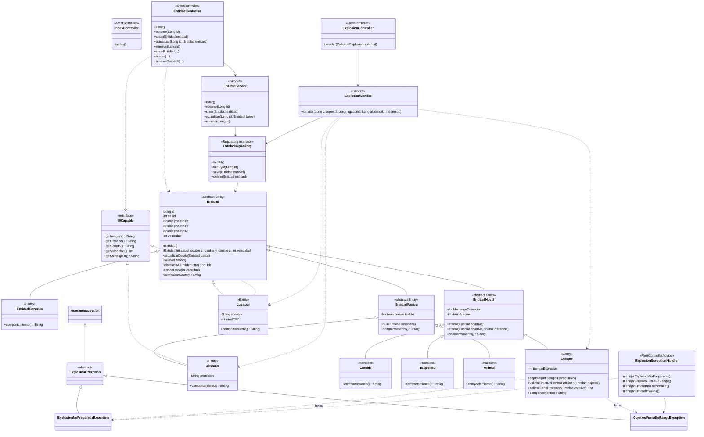

# Minecraft - POO-08

Servicio HTTP de Lenguaje de Programación 3 desarrollado con Java 21 y Spring Boot. El proyecto modela entidades de Minecraft y extiende el trabajo de POO-06 y POO-07 con persistencia polimórfica en H2, CRUD REST, una interfaz de dominio, dos reglas de explosión, una simulación transaccional, excepciones específicas y una colección de Insomnia reproducible.

## Objetivo

Persistir y consultar una familia de entidades, ejecutar una explosión entre un `Creeper`, un `Jugador` y un `Aldeano`, guardar el daño resultante y representar por HTTP los casos válidos y las violaciones de las reglas del juego.

Las dos reglas propias son:

1. Un Creeper solo puede explotar cuando el tiempo transcurrido alcanza su tiempo de detonación.
2. Cada objetivo debe estar dentro del radio del Creeper antes de aplicar daño; todos los objetivos se prevalidan para evitar resultados parciales.

Fuentes verificadas: [enunciado oficial POO-08](https://github.com/alefq/afq-taller-git-2024/blob/main/docs/ejercicio-poo-08-crud-h2-insomnia-2026-10-28.md) y [rúbrica LP3 2026](https://github.com/alefq/afq-taller-git-2024/blob/main/docs/RUBRICA-ejercicios-lp3-2026.md).

## Tecnologías

- JDK 21.
- Spring Boot 4.1.1.
- Spring Web MVC.
- Spring Data JPA.
- H2 persistente en desarrollo y H2 en memoria para pruebas.
- Maven Wrapper incluido.

## Ejecución

Desde la raíz del repositorio:

```bash
cd minecraft
./mvnw spring-boot:run
```

La API queda disponible en `http://localhost:8080`.

Para verificar las herramientas:

```bash
java -version
cd minecraft
./mvnw --version
```

## Configuración H2

El archivo `minecraft/src/main/resources/application.properties` contiene:

| Propiedad | Función |
|---|---|
| `spring.application.name=minecraft` | Identifica la aplicación dentro de Spring Boot. |
| `spring.datasource.url=jdbc:h2:file:./data/entidades` | Guarda la base en `minecraft/data/entidades.mv.db` cuando la aplicación se inicia desde `minecraft`. |
| `spring.datasource.driver-class-name=org.h2.Driver` | Selecciona el driver JDBC de H2. |
| `spring.datasource.username=sa` | Define el usuario de desarrollo. |
| `spring.datasource.password=` | Usa contraseña vacía solo para este entorno académico local. |
| `spring.jpa.hibernate.ddl-auto=update` | Conserva los datos y actualiza el esquema cuando cambia el modelo; no reinicia la base en cada arranque. |
| `spring.h2.console.enabled=true` | Habilita la consola web de H2. |

La consola está en `http://localhost:8080/h2-console`:

- JDBC URL: `jdbc:h2:file:./data/entidades`
- Usuario: `sa`
- Contraseña: vacía

Tablas principales: `ENTIDADES`, `ENTIDADES_GENERICAS`, `ENTIDADES_HOSTILES`, `CREEPERS`, `JUGADORES`, `ENTIDADES_PASIVAS` y `ALDEANOS`.

Las pruebas no usan ese archivo. `minecraft/src/test/resources/application.properties` configura `jdbc:h2:mem:minecraft-test`, `ddl-auto=create-drop` y deshabilita la consola.

## Pruebas

```bash
cd minecraft
./mvnw test
```

El estado documentado tiene 68 ejecuciones JUnit:

| Categoría | Ejecuciones |
|---|---:|
| Contexto de Spring | 1 |
| Dominio | 16 |
| Servicio | 5 |
| Integración con MockMvc | 46 |
| **Total** | **68** |

También se verificó la suite con orden aleatorio mediante `./mvnw -Dsurefire.runOrder=random test`.

## API REST

### Resumen

| Método | Ruta | Resultado principal |
|---|---|---|
| `GET` | `/` | Estado de la aplicación. |
| `GET` | `/entidad` | Construcción transitoria de seis tipos del dominio. |
| `GET` | `/entidad/atacar` | Demostración de los métodos `atacar` sobrecargados. |
| `GET` | `/ui` | Lectura polimórfica mediante `UICapable`. |
| `GET` | `/entidades` | Lista la familia persistida. |
| `GET` | `/entidades/{id}` | Obtiene una entidad persistida. |
| `POST` | `/entidades` | Crea una entidad y devuelve 201. |
| `PUT` | `/entidades/{id}` | Reemplaza los datos de una entidad del mismo subtipo. |
| `DELETE` | `/entidades/{id}` | Elimina físicamente una entidad y devuelve 204. |
| `POST` | `/explosiones/simular` | Ejecuta y persiste una explosión. |

### GET /

Respuesta `200 OK`:

```json
{
  "estado": "API funcionando",
  "dominio": "Minecraft",
  "autora": "María Sol Ferreira"
}
```

### GET /entidad

Construye un objeto transitorio y llama `comportamiento()` mediante una referencia `Entidad`. No guarda datos.

| Parámetro | Obligatorio | Predeterminado | Uso |
|---|---|---|---|
| `tipo` | Sí | Sin valor | `creeper`, `zombie`, `esqueleto`, `aldeano`, `animal` o `jugador`, sin distinguir mayúsculas. |
| `salud` | Sí | Sin valor | Entero mayor que 0. |
| `x`, `y`, `z` | No | `0` | Coordenadas finitas. |
| `velocidad` | No | `1` | Entero no negativo. |
| `rango` | No | `10` | Rango finito y no negativo de las entidades hostiles. |
| `dano` | No | `5` | Daño positivo de las entidades hostiles. |
| `tiempoExplosion` | No | `3` por constructor | Tiempo positivo del Creeper. |
| `profesion` | No | `Granjero` | Profesión no vacía del Aldeano. |
| `domesticable` | No | Aldeano `true`; Animal `false` | Estado de una entidad pasiva. |
| `montar` | No | `false` | Estado propio de Animal. |
| `nombre` | No | `Steve` | Nombre no vacío de Jugador. |
| `experiencia` | No | `0` | Nivel no negativo de Jugador. |

Ejemplo:

```bash
curl -i "http://localhost:8080/entidad?tipo=creeper&salud=20&x=1&y=2&z=3&velocidad=4&rango=10&dano=5&tiempoExplosion=3"
```

Respuesta `200 OK`:

```json
{
  "tipo": "Creeper",
  "salud": 20,
  "posicion": "(1.0, 2.0, 3.0)",
  "velocidad": 4,
  "comportamiento": "El creeper se acerca en silencio y explota en 3 segundos.",
  "constructor": "completo",
  "rangoDeteccion": 10.0,
  "danoAtaque": 5,
  "tiempoExplosion": 3
}
```

Un tipo desconocido, una invariante inválida o un parámetro requerido ausente produce `400 Bad Request`.

### GET /entidad/atacar

Sin `distancia` llama `atacar(Entidad)`. Con `distancia` llama `atacar(Entidad, double)` y valida el rango.

```bash
curl -i "http://localhost:8080/entidad/atacar?saludObjetivo=20&rango=10&dano=6&distancia=4"
```

```json
{
  "atacante": "Creeper",
  "variante": "atacar(Entidad, double)",
  "saludInicial": 20,
  "saludFinal": 14,
  "danoAplicado": 6,
  "distancia": 4.0
}
```

### GET /ui

El controller declara una referencia `UICapable` y puede asignarle un `Jugador` o un `Aldeano`.

```bash
curl -i "http://localhost:8080/ui?tipo=jugador&nombre=Alex&experiencia=12&salud=30&x=2"
```

```json
{
  "tipo": "Jugador",
  "imagen": "jugador.png",
  "posicion": "(2.0, 0.0, 0.0)",
  "sonido": "Sonido del jugador",
  "velocidad": 1,
  "mensaje": "Entidad visible en (2.0, 0.0, 0.0) con velocidad 1."
}
```

### CRUD /entidades

`Entidad` es una raíz abstracta. Jackson exige el discriminador `tipo` en `POST` y `PUT`:

| `tipo` | Clase | Campos propios |
|---|---|---|
| `entidad` | `EntidadGenerica` | Solo los campos comunes. |
| `creeper` | `Creeper` | `rangoDeteccion`, `danoAtaque`, `tiempoExplosion`. |
| `jugador` | `Jugador` | `nombre`, `nivelEXP`; también acepta el alias `experiencia`. |
| `aldeano` | `Aldeano` | `domesticable`, `profesion`. |

`EntidadGenerica` conserva la representación neutral de registros creados antes de volver abstracta la raíz. Los tres participantes persistentes de la simulación son Creeper, Jugador y Aldeano.

Crear un Creeper:

```bash
curl -i -X POST "http://localhost:8080/entidades" \
  -H "Content-Type: application/json" \
  -d '{
    "tipo":"creeper",
    "salud":20,
    "posicionX":0,
    "posicionY":0,
    "posicionZ":0,
    "velocidad":1,
    "rangoDeteccion":5,
    "danoAtaque":6,
    "tiempoExplosion":3
  }'
```

La respuesta es `201 Created`, incluye el `id` generado y una cabecera `Location: /entidades/{id}`.

Un cuerpo sin `tipo`, con un tipo desconocido o con estado inválido devuelve `400`. Un `GET`, `PUT` o `DELETE` sobre un ID inexistente devuelve `404`. El `PUT` no permite cambiar el subtipo existente.

### POST /explosiones/simular

La simulación recibe IDs ya persistidos; no crea participantes ni recibe sus posiciones. `ExplosionService` carga y verifica los tipos, ejecuta las dos reglas y guarda la salud final del Jugador y del Aldeano dentro de una transacción.

```json
{
  "creeperId": 1,
  "jugadorId": 2,
  "aldeanoId": 3,
  "tiempoTranscurrido": 3
}
```

Respuesta `200 OK` resumida:

```json
{
  "evento": "Explosión de Creeper",
  "clasesParticipantes": ["Creeper", "Jugador", "Aldeano"],
  "creeperId": 1,
  "tiempoExplosion": 3,
  "tiempoTranscurrido": 3,
  "radioExplosion": 5.0,
  "danoBase": 6,
  "objetivos": [
    {
      "tipo": "Jugador",
      "id": 2,
      "identificador": "Alex",
      "distancia": 2.0,
      "saludInicial": 30,
      "saludFinal": 24,
      "danoRecibido": 6
    }
  ]
}
```

Los valores de tiempo, radio y daño salen del Creeper persistido. Las distancias se calculan en tres dimensiones entre las posiciones persistidas.

## Códigos HTTP

| Código | Caso |
|---:|---|
| `200` | Lecturas, construcción transitoria, interfaz, ataque, actualización y simulación válida. |
| `201` | Entidad creada. |
| `204` | Entidad eliminada. |
| `400` | JSON, tipo, ID de tipo incorrecto o invariante inválida. |
| `404` | Entidad inexistente. |
| `409` | El Creeper todavía no alcanzó su tiempo de detonación. |
| `422` | Al menos un objetivo está fuera del radio de explosión. |

Los errores del CRUD usan `error` y `mensaje`. Los errores manejados por `ExplosionExceptionHandler` usan `error`, `mensaje` y `estado`. No existe un handler genérico de `Exception` que oculte fallos inesperados.

## Colección Insomnia

Archivo: `insomnia/poo08-minecraft.json`.

La colección contiene 25 solicitudes distribuidas en preparación, consultas, simulación persistente, errores y limpieza. La estructura JSON fue validada estáticamente; no se afirma una importación gráfica desde Insomnia.

Orden reproducible:

1. Iniciar la aplicación desde `minecraft`.
2. Importar `insomnia/poo08-minecraft.json` con la opción de importar archivo.
3. Ejecutar las tres creaciones y copiar los IDs devueltos a `creeper_id`, `jugador_id` y `aldeano_id` en `Base Environment`.
4. Ejecutar las consultas iniciales y el endpoint `UICapable`.
5. Ejecutar una sola vez la explosión válida y comprobar la salud con los GET posteriores.
6. Ejecutar el POST inválido, el 404, el 409 y el GET que confirma que no hubo cambios.
7. Mover el Aldeano con PUT, comprobarlo, provocar el 422 y verificar que no hubo daño parcial.
8. Ejecutar la limpieza; el GET posterior al primer DELETE debe devolver 404.

La colección usa IDs creados en la propia ejecución. No se deben sustituir por IDs adivinados o preexistentes.

## Qué hay que pensar

### Recurso y verbo

El recurso principal es `entidades`. La colección se llama `/entidades`; el verbo HTTP expresa crear, leer, reemplazar o borrar. `/explosiones/simular` representa la acción de simulación pedida por la consigna y opera sobre entidades existentes.

### Identidad

La clave es `Entidad.id`, de tipo `Long`, anotada con `@Id` y `@GeneratedValue(IDENTITY)`. H2 asigna el valor. El JSON de creación debe omitir `id`; la respuesta 201 devuelve el identificador generado.

### Herencia y tablas

Se eligió `InheritanceType.JOINED`. Los atributos comunes viven en `ENTIDADES` y cada subtipo persistente agrega su tabla. Esta estrategia evita repetir salud, posición y velocidad, conserva una jerarquía polimórfica y permite consultarla mediante `EntidadRepository`; el costo aceptado es realizar joins.

El subtipo JSON se distingue con la propiedad obligatoria `tipo` mediante `@JsonTypeInfo` y `@JsonSubTypes`. Ese valor pertenece al contrato JSON, no es una columna discriminadora de JPA.

### Interfaz y repositorio

`EntidadRepository` es una interfaz que extiende `JpaRepository<Entidad, Long>`. Spring Data genera su implementación, por lo que los servicios dependen de un contrato y no de SQL o de una clase concreta. `EntidadController` depende de `EntidadService`; el servicio encapsula el uso del repositorio y las transacciones.

Esto se relaciona con `UICapable`: ambos son contratos. El repositorio abstrae persistencia; `UICapable` abstrae qué información visual puede pedir el endpoint.

### Protocolo del dominio

`UICapable` declara imagen, posición, sonido, velocidad y un mensaje predeterminado. `Jugador` y `Aldeano`, ubicados en ramas distintas del modelo, lo implementan. `GET /ui` usa una referencia `UICapable` y funciona con cualquiera de los dos.

### Ocultamiento

Constructores, setters validados, `validarEstado()`, callbacks `@PrePersist/@PreUpdate` y métodos del dominio sostienen las invariantes. El controller no asigna campos directamente. En Insomnia, el POST con `tiempoExplosion=0` devuelve 400 y el GET siguiente permite comparar la misma cantidad e IDs que antes del intento.

### PUT y PATCH

Se implementó `PUT`, no `PATCH`. El cuerpo representa el estado completo del mismo subtipo; `actualizarDesde` impide cambiar la clase. Jackson asigna valores Java predeterminados a campos omitidos: algunos incumplen invariantes y producen 400, mientras otros, como un booleano, pueden reemplazarse por `false`. Por eso el cliente debe enviar todos los campos del subtipo.

### DELETE

El borrado es físico. `EntidadService` verifica primero que el ID exista y luego llama `EntidadRepository.delete`. No hay una regla adicional de dominio para borrar; por eso el resultado se expresa con `204 No Content`, y un GET posterior devuelve 404.

### Dos reglas

`Creeper.explotar(int)` valida el tiempo y puede lanzar `ExplosionNoPreparadaException`. `Creeper.validarObjetivoDentroDelRadio(Entidad)` valida la distancia y puede lanzar `ObjetivoFueraDeRangoException`. Solo después de prevalidar ambos objetivos se aplica el daño. Un GET posterior muestra la salud persistida.

### Excepciones

`ExplosionException` es la base abstracta. Sus hijas nombran las dos reglas: `ExplosionNoPreparadaException` y `ObjetivoFueraDeRangoException`. La primera produce 409 y la segunda 422 mediante handlers separados. Un ID inexistente usa `NoSuchElementException` y produce 404; un ID nulo, de tipo incorrecto o un estado inválido usa `IllegalArgumentException` y produce 400.

Las excepciones del dominio son no comprobadas porque extienden `RuntimeException`: no obligan a contaminar cada firma con `throws` y provocan rollback transaccional por defecto. Los errores HTTP contienen una categoría legible y el mensaje específico.

## Herencia, sobrecarga y sobreescritura

`Entidad` es abstracta y declara `comportamiento()`. `EntidadGenerica`, Creeper, Zombie, Esqueleto, Aldeano, Animal y Jugador aportan implementaciones concretas. `EntidadHostil` y `EntidadPasiva` mantienen el método abstracto en las categorías intermedias.

La sobrecarga se observa en los tres constructores públicos de Creeper, de cinco, siete y ocho parámetros, y en `EntidadHostil.atacar(Entidad)` frente a `atacar(Entidad, double)`. La sobreescritura conserva la misma firma entre padre e hijas; la sobrecarga cambia la lista de parámetros.

Los constructores sin argumentos de las entidades JPA son `protected`: Hibernate puede usarlos, pero no forman parte de la API pública de construcción del dominio.

## Diagrama de clases



## Organización

```text
py.edu.uc.lp3.msferreira.minecraft
├── MinecraftApplication.java
├── domain
│   ├── Entidad.java
│   ├── EntidadGenerica.java
│   ├── EntidadHostil.java
│   ├── EntidadPasiva.java
│   ├── Creeper.java
│   ├── Jugador.java
│   ├── Aldeano.java
│   ├── Zombie.java
│   ├── Esqueleto.java
│   ├── Animal.java
│   ├── UICapable.java
│   └── exception
├── repository
│   └── EntidadRepository.java
├── service
│   ├── EntidadService.java
│   └── ExplosionService.java
└── rest
    ├── controller
    │   ├── IndexController.java
    │   ├── EntidadController.java
    │   └── ExplosionController.java
    └── exception
        └── ExplosionExceptionHandler.java
```

## Entregables

- Especificación actual: [ESPECIFICACION-POO08.md](ESPECIFICACION-POO08.md).
- Especificación histórica: [ESPECIFICACION-POO06.md](ESPECIFICACION-POO06.md).
- Bitácora de IA: [BITACORA.md](BITACORA.md).
- Colección: [insomnia/poo08-minecraft.json](insomnia/poo08-minecraft.json).
- Licencia: [Apache License 2.0](LICENSE).

El enlace exacto al commit se debe copiar en Classroom después de crear y publicar el commit final. El SHA anterior no representa cambios todavía no confirmados.

## Verificación realizada

- Pruebas automatizadas normales y con orden aleatorio: 68 aprobadas, 0 fallidas.
- Arranque contra H2 persistente y consultas GET de los subtipos existentes.
- Validación estática del JSON, IDs internos, referencias padre y cuerpos de la colección Insomnia.
- No se realizó importación gráfica de la colección porque Insomnia y `inso` no están instalados en este entorno.

## Licencia

Este proyecto se distribuye bajo la [Apache License 2.0](LICENSE).
